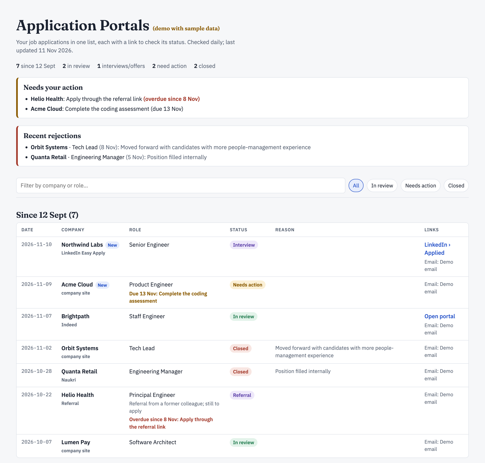

*Sample tracker page. All names, companies and roles are fictional.*

# Job Application Tracker (agent skill)

Tracks your job applications from your email inbox. It finds every application (career sites, LinkedIn Easy Apply, Naukri/Indeed, recruiters, referrals), works out each status, keeps a single tracker page with candidate-portal links, detects rejections (with the reason), interview invites and offers, and reminds you about pending actions. It works with Gmail, Outlook, Yahoo, iCloud, Zoho and custom domains.

It reads only your own mail and bundles no data.

Built for Claude, with setup instructions for Codex and Cursor too. Claude gets the full experience: a published tracker page and built-in daily scheduling. Other agents store the tracker in a local `job-tracker/` folder and need a manual or cron-based daily check.

**[Download the latest `.skill` file](https://github.com/swapnil-salunke/job-application-tracker/releases/latest/download/job-application-tracker.skill)** · [Live demo](https://swapnil-salunke.github.io/job-application-tracker/) · [All releases](https://github.com/swapnil-salunke/job-application-tracker/releases)

## Releases

| Version | Date | What's new |
|---|---|---|
| [v1.2.2](https://github.com/swapnil-salunke/job-application-tracker/releases/tag/v1.2.2) | 2026-11-11 | Refreshed preview image, releases table and a deduplicated README; CI automation for the demo and `.skill` file |
| [v1.2.1](https://github.com/swapnil-salunke/job-application-tracker/releases/tag/v1.2.1) | 2026-11-11 | Live demo page (GitHub Pages) and a fix for garbled characters in the tracker page |
| [v1.2.0](https://github.com/swapnil-salunke/job-application-tracker/releases/tag/v1.2.0) | 2026-11-11 | Rejection reasons: "Recent rejections" box and a Reason column |
| [v1.1.0](https://github.com/swapnil-salunke/job-application-tracker/releases/tag/v1.1.0) | 2026-10-21 | Codex (`AGENTS.md`) and Cursor (`.cursor/rules`) support |
| [v1.0.2](https://github.com/swapnil-salunke/job-application-tracker/releases/tag/v1.0.2) | 2026-10-21 | Direct download link to the latest release in the README |
| [v1.0.1](https://github.com/swapnil-salunke/job-application-tracker/releases/tag/v1.0.1) | 2026-10-21 | Step-by-step install and setup guide in the README |
| [v1.0.0](https://github.com/swapnil-salunke/job-application-tracker/releases/tag/v1.0.0) | 2026-10-21 | Initial release |

Full list: [all releases](https://github.com/swapnil-salunke/job-application-tracker/releases).

## Step-by-step guide

### 1. Install

| Where | How |
|---|---|
| **Claude app** | Download the `.skill` file above, then **Settings > Skills > Upload skill** and switch it on. |
| **Claude Code** | `git clone https://github.com/swapnil-salunke/job-application-tracker.git ~/.claude/skills/job-application-tracker` |
| **Codex** | Clone the repo into your project. Codex reads [`AGENTS.md`](AGENTS.md), which points to `SKILL.md`. |
| **Cursor** | Clone the repo and open it, or copy `SKILL.md`, `scripts/`, `references/`, `assets/` and `.cursor/rules/job-application-tracker.mdc` into your project. |

In Codex and Cursor the mailbox connects over IMAP (or a mail MCP server) rather than a Claude connector.

### 2. Start setup
In a new chat, say **"Set up my job application tracker"**. Your agent asks for the email address you use for job applications.

### 3. Connect your mailbox
Your agent detects your email provider and picks the first method that works:

1. **Native connector** (Gmail, Outlook/Microsoft 365). You sign in through the normal OAuth screen. No password is shared.
2. **Integration hub** such as Zapier, after you connect your account there.
3. **IMAP with an app password.** It walks you through creating one for your provider and storing it as environment secrets (`MAIL_IMAP_HOST`, `MAIL_USER`, `MAIL_APP_PASSWORD`). Never paste your real password into chat.
4. **Forwarding.** You auto-forward job-related mail to an inbox the agent can read.

The agent confirms the connection with one test search.

### 4. First scan
The agent scans the last 60 days of mail and builds your tracker: one list with company, role, source, date applied, status, candidate-portal link and any action due.

### 5. Daily use
Ask any time: "Check my applications", "What are my overdue action items?" or "Which applications have a candidate portal link?"

### 6. Automate it (optional)
Say **"Run the tracker daily at 9 am"**. The daily check adds new applications, detects status changes and notifies you only when something is new, changed or due.

### 7. Share your tracker (optional)
The tracker contains company names and dates, so share it view-only and only with people you trust.

## What's inside

| Path | Purpose |
|---|---|
| `SKILL.md` | Instructions the agent follows |
| `scripts/detect_provider.py`, `scripts/imap_search.py` | Identify your email provider; search mail over IMAP |
| `references/` | Data schema and provider connection details |
| `assets/tracker-page.html` | Tracker page template |
| `AGENTS.md`, `.cursor/rules/` | Entry points for Codex and Cursor |
| `docs/index.html` | Live demo page (GitHub Pages), built by `scripts/build_demo.py` |
| `.github/workflows/` | Auto-rebuilds the demo and attaches the `.skill` file to releases |

## License
MIT. See [LICENSE](LICENSE).
